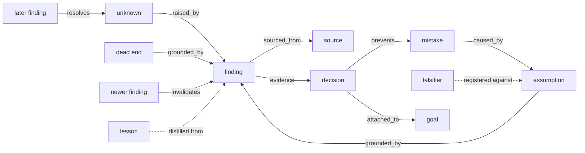
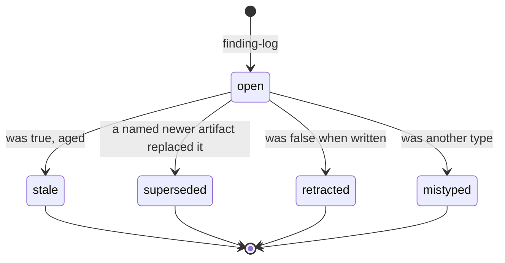
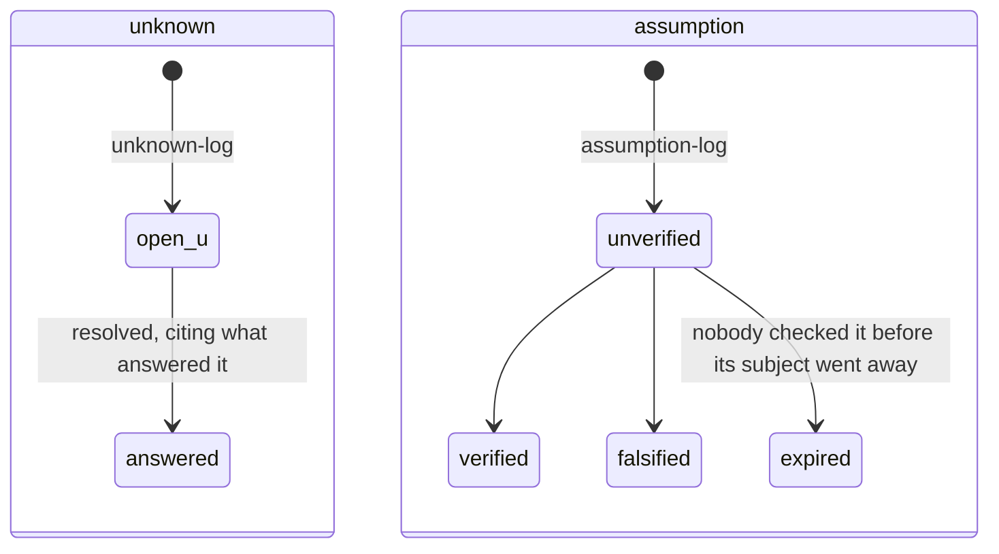
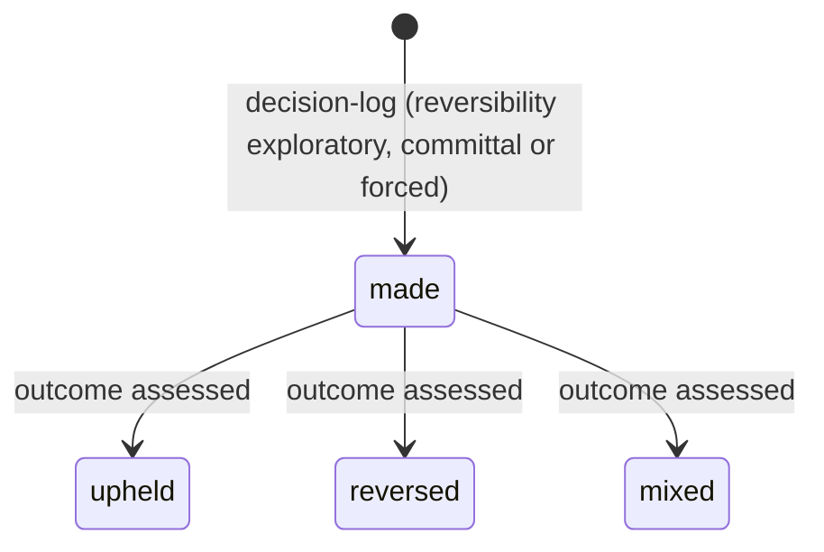
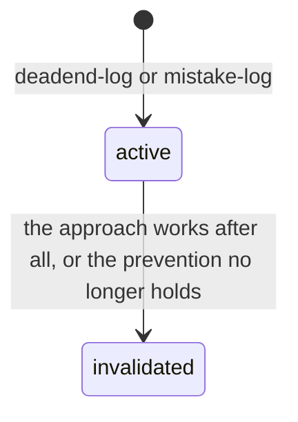
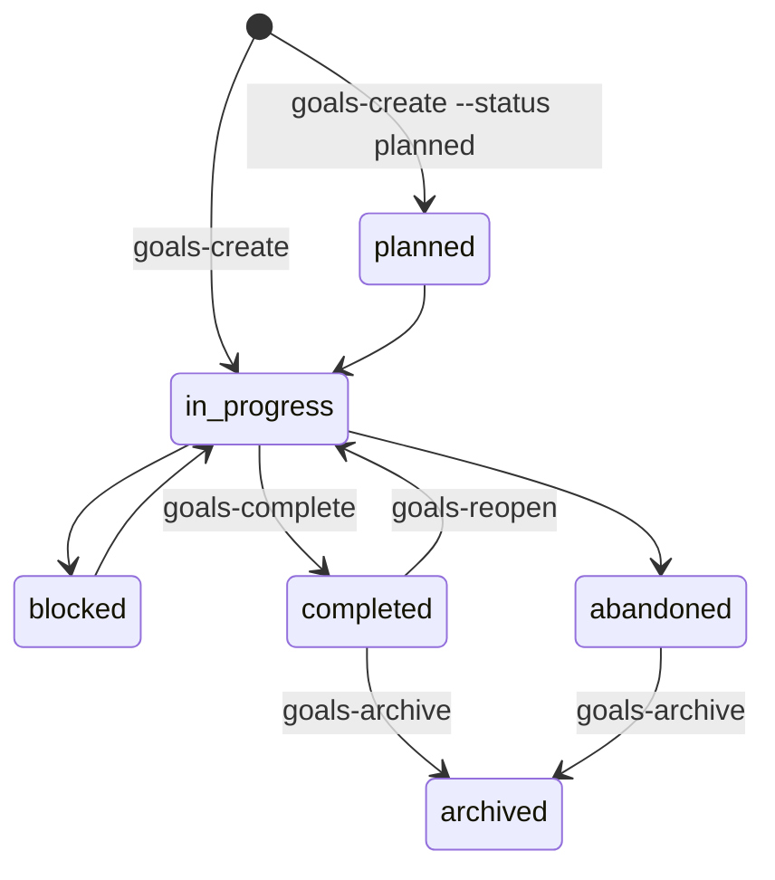
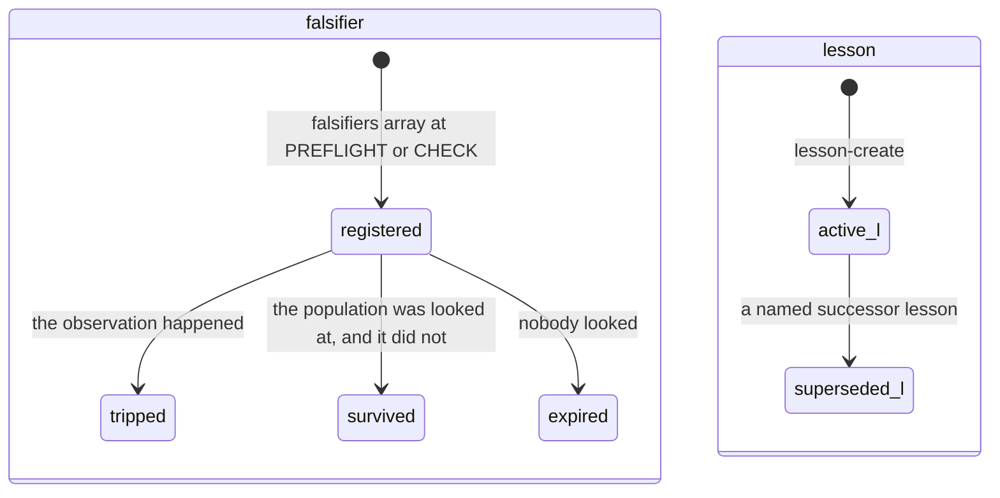
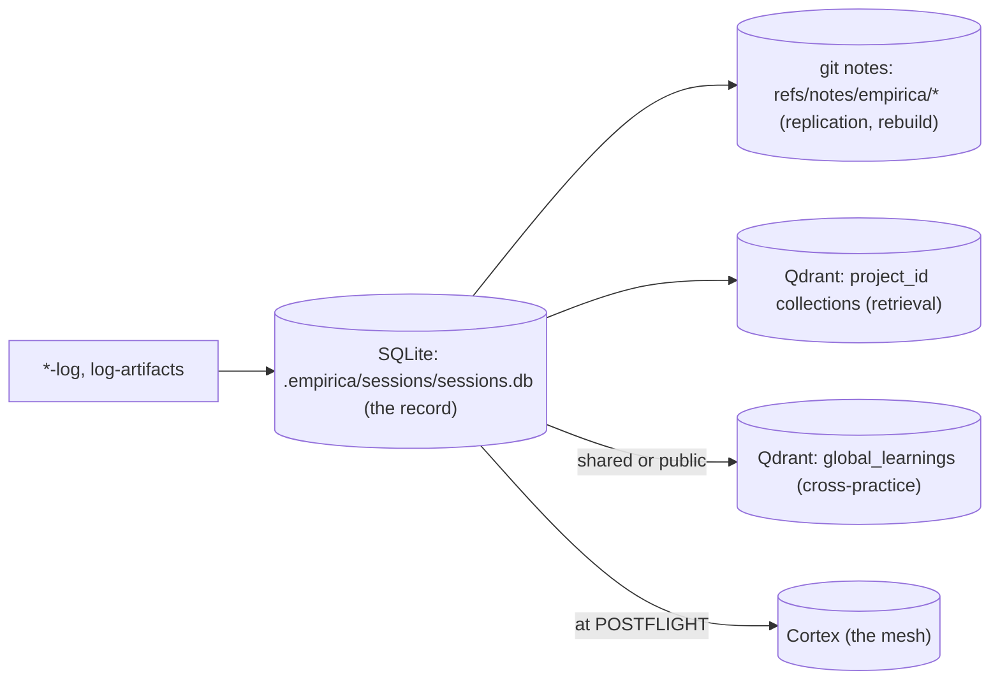

# The Artifact Graph

How Empirica's epistemic artifacts connect, change state, where they are stored, who they belong to, and how they are shared.
[TAXONOMY.md](TAXONOMY.md) defines each concept. [ARTIFACT_LIFECYCLE_AND_OUTCOME_FEEDBACK.md](../architecture/ARTIFACT_LIFECYCLE_AND_OUTCOME_FEEDBACK.md)
explains why the lifecycle works as it does. The `/artifact-graph` skill is the short version for the moment you log.

Vocabularies here are the ones the CLI prints. When this page and a command disagree, the command is right:

| Vocabulary | Command that prints it |
|---|---|
| Link relations, node types, required fields | `empirica log-artifacts --schema` |
| Transitions and their fields | `empirica resolve-artifacts --schema` |
| Metadata you can correct | `empirica update-artifacts --schema` |
| Falsifier states | `empirica falsifier-list --help` |

---

## 1. The types

Each type answers a different question. Logging everything as a finding loses that.

| Type | The question it answers | SQLite table | Git notes | Qdrant (per practice) |
|---|---|---|---|---|
| finding | What is true that I did not know? | `project_findings` | `empirica/findings/*` | `project_<id>_memory` |
| unknown | What do I know I don't know? | `project_unknowns` | `empirica/unknowns/*` | `project_<id>_memory` |
| assumption | What am I taking for granted without checking? | `assumptions` | `empirica/assumptions/*` | `project_<id>_assumptions` |
| decision | What did I choose, against what, and what would reverse it? | `decisions` | `empirica/decisions/*` | `project_<id>_decisions` |
| dead_end | What approach does not work? | `project_dead_ends` | `empirica/dead_ends/*` | `project_<id>_memory` |
| mistake | What did I do wrong, and what prevents it? | `mistakes_made` | `empirica/mistakes/*` | `project_<id>_memory` |
| lesson | What pattern can another practice pick up? | `lessons` | `empirica/lessons/*` | `project_<id>_memory` |
| falsifier | What observation would refute a belief I act on? | `falsifiers` | `empirica/falsifiers/*` | none |
| source | Where did an external claim come from? | `epistemic_sources` | `empirica/sources/*` | none |
| goal, task | What am I doing, in what steps? | `goals`, `subtasks` | `empirica/goals/*`, `empirica/tasks/*` | `project_<id>_goals` |

The confusions that matter most:

- A bug in the code is a **finding**. You shipping it is a **mistake**.
- Something you have not checked is an **assumption**. Something you know you don't know is an **unknown**.
- An inference inside an observation is **two artifacts**: the observation is a finding, and what you supplied is an assumption
  linked to it.
- A finding *describes* this practice. A **lesson** *transfers* a pattern to others.

## 2. The links

An edge reads from, relation, to. `log-artifacts` writes nodes and edges in one call; `--edge ID:RELATION` on any `*-log` adds
one.

| Relation | Read it as |
|---|---|
| `evidence` | from supports to |
| `grounded_by` | from rests on to |
| `raised_by` | from (usually an unknown) was raised by to |
| `resolves` | from answers to |
| `invalidates` | from shows to was wrong or no longer applies; metadata `kind` says retracted, superseded or stale |
| `sourced_from` | from came from the source to |
| `caused_by` | from (usually a mistake) was caused by to |
| `prevents` | from (a decision or a prevention) prevents to |
| `attached_to` | structural: the artifact belongs to a goal. Written for you |
| `related` | asserts almost nothing. Use it last |

Most edges should reach artifacts from **earlier** transactions. If every edge joins two nodes created in the same batch, the
graph is one disconnected island per transaction.

## 3. Lifecycles

Every transition goes through `resolve-artifacts` (single verbs such as `finding-resolve` and `unknown-resolve` exist for one
artifact). A transition deletes nothing: a resolved artifact leaves live retrieval and keeps its history. `delete-artifacts` is
for test noise and literal duplicates only.

### Finding

`retracted` and `stale` feel alike and are not: one records an error, the other ageing. A practice whose resolutions are almost
all `stale` has no way to say it was wrong. Correct a wrong *claim* by retracting it; correct wrong *metadata* (impact,
visibility, epistemic source) with `update-artifacts`. Claim text is never edited.

### Unknown and assumption

`expired` counts as neither verified nor falsified. It is the honest state for a claim that was never tested.

### Decision

An assessment can carry a self-assessed `regret` from 0 to 1.

### Dead end and mistake

Never resolve or delete a dead end or mistake for being old: they are meant to resurface. Invalidate one only when something
showed the constraint false.

### Goal

A planned goal can carry a due date (`--due`) and comes back up at session start when it is due.

### Falsifier and lesson

A falsifier outlives its transaction and resurfaces at every PREFLIGHT until it is adjudicated. A `survived` verdict without
evidence that the population was examined is recorded as `expired`.

## 4. Ownership

| Field | Means |
|---|---|
| `project_id` | The practice the artifact belongs to. Artifacts accrue to the practice |
| `created_by_ai` | The practitioner (`ai_id`) who logged it. Calibration accrues to the practitioner |
| `session_id`, `transaction_id` | When it was logged. Sessions are compaction boundaries, not lifecycle scopes |
| `goal_id` | The work it belongs to. Attached for you: the transaction's goal, else the session's latest open goal, else the practice's latest goal in progress |

`--project-id <name or uuid>` on the log verbs, `log-artifacts` and `goals-create` writes into another practice. That is how a
practice sends a question to the research practice, for example.

## 5. Where they live

- **SQLite** is the record. Everything else is derived from it.
- **Git notes** carry each artifact with the repository: `sync-push` and `sync-pull` replicate them, and `rebuild --from-notes`
  restores the database. `refs/notes/empirica-archive/*` holds archived artifacts.
- **Qdrant** serves semantic retrieval (PREFLIGHT, `project-search`). `project-embed` rebuilds a practice's collections from
  SQLite.
- **Cortex** receives a POSTFLIGHT's artifacts when the practice is registered there.

## 6. Sharing

| Mechanism | What it does | Who sees it |
|---|---|---|
| `--visibility local` (default) | nothing leaves the practice | this practice |
| `--visibility shared` | marks findings, unknowns, dead ends for federation | the organisation's practices |
| `--visibility public` | the same, wider | anyone with a Cortex account |
| lesson `sharing_policy` | `private`, `project`, `org`, `public`, `licensed`; `org` and `public` federate | as named |
| `project-search --global` | searches `global_learnings` and this machine's other practices | the searcher |
| `--project-id` | logs straight into another practice | that practice |
| mesh (`cortex_collab`, `cortex_propose`) | a question, an FYI, a request for work | the addressed practice |

What reaches `global_learnings`: unresolved findings with impact 0.7 or more that are shared or public; resolved unknowns that
are shared or public; shared or public dead ends; lessons whose policy is `org` or `public`. A superseded lesson does not
federate. Assumptions and decisions accept `--visibility`, but nothing federates them yet.

There is no verb that **moves** an existing artifact to another practice. Share it, or log the follow-up into the other practice
with `--project-id` and cite the original.

## 7. Use by context

Measured across 33 practices on one machine (2026-11-13), as ratios per 100 findings for the 13 practices with 100 or more
findings. There are one or two practices per type, all running the same model and prompt, so the numbers describe current use,
not what each context needs.

**What every practice shares, whatever its type:**

- Assumptions are 1 to 4 per 100 findings everywhere. Most uncertainty is never typed.
- Decision outcomes are recorded for 0 to 4% of decisions. Choices are logged and never graded.
- Provenance is almost unused: 14 `sourced_from` links across about 10,300 findings.

These are the first gaps to close in any practice.

**Where context shows.** The last column is a recommendation, not a measurement.

| Practice type | Measured | Suggested emphasis |
|---|---|---|
| software (cli, service, web-app, browser-extension) | findings, dead ends and mistakes carry most; 15 to 29 decisions per 100 findings | dead ends and mistakes with a real prevention; findings tied to commits |
| content | 53 decisions and 26 sources per 100 findings, the most of any type | `sourced_from` on every claim from outside; decisions graded by how the piece landed |
| engagement | the densest links, 1.6 edges per artifact | assumptions about the client, verified or falsified with them; decisions with the client's reversal conditions |
| operations | 10 to 14 mistakes per 100 findings; few assumptions | mistakes whose prevention names the check; falsifiers on the state of running systems |
| research | one practice, new, nothing to measure yet | unknowns as research questions; assumptions as hypotheses; falsifiers registered before the experiment; lessons for what transfers |

A transaction's `work_type` (code, research, docs, debug, infra, release, remote-ops, config, data, comms, design, audit) changes
how evidence is weighted at POSTFLIGHT. It does not change which artifacts are available.

## 8. Known gaps

- Adjudicating a falsifier `tripped` does not invalidate its parent artifact; that takes a separate `resolve-artifacts` call.
- Dead-end and mistake invalidations are not mirrored to git notes, so a `rebuild --from-notes` shows them valid again.
- A retracted finding does not lower its source's accuracy.
- Blindspot provenance (`derived_from`) has a column and a function, and nothing writes it.
- Assumptions and decisions accept `--visibility` and are never federated.
